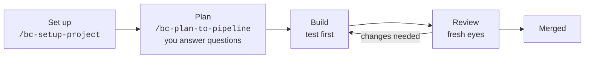
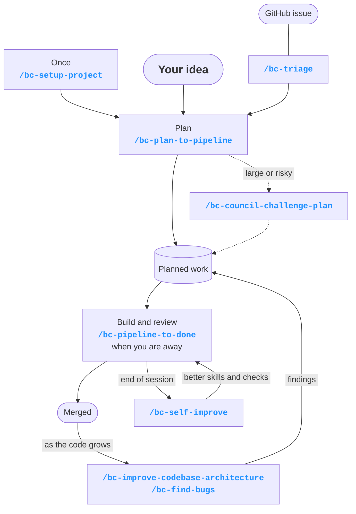

<div align="center">

# Agent concepts

**Skills that make coding agents plan first, test first, and remember.**

[](https://github.com/bendecastro/agent-concepts/actions/workflows/gate.yml)
[](https://github.com/bendecastro/agent-concepts/releases)
[](LICENSE)

[How it works](#how-these-skills-work) · [The workflow](#the-workflow) · [Install](#install) · [Contributing](#working-on-this-repository)

</div>

---

Skills and rules for coding agents — a way of working where questions get settled before code is written, every test is proved able to fail before it is trusted, and work lives in
files so your project builds intrinsic long-term memory.

Install them once and they work in the coding agent you already use: **Claude Code**, **Codex**, **Pi**, Cursor, or any other harness. All skills are prefixed with `bc-` so they don't conflict with the ones you already have, and uninstalling them is straightforward.

## How these skills work

Eight ideas run through the whole set.

### Settle questions before building

An agent that guesses what you wanted builds the wrong thing quickly. So the agent asks you questions one at a time until every decision in a plan is made, explores ideas with you
before they become plans, and brings real choices to you instead of deciding and then building something you didn't want.

**Skills:** [bc-grilling](concepts/bc-grilling/body/SKILL.md) · [bc-brainstorming](concepts/bc-brainstorming/body/SKILL.md) · [bc-plan-to-pipeline](concepts/bc-plan-to-pipeline/body/SKILL.md) · the [agent kernel](concepts/agent-kernel/body/AGENT-KERNEL.md), a short set of rules the agent reads in every session

### Test first, and prove the test can fail

The agent write a test first and watch it fail, then writes the code that makes it pass. A test that has never failed proves nothing, so when the code already works, the agent breaks it on purpose, checks that the test notices, and undoes the break.

Every change gets ordinary example tests. Logic that follows a clear rule (calculations, parsers, sorting) also gets tests that try hundreds of inputs automatically. Mathematical
proof is off unless you turn it on, and the agent suggests it where a mistake would be costly.

**Skills:** [bc-tdd](concepts/bc-tdd/body/SKILL.md)

### Evidence before claims

"It works" means nothing until it has been checked. The agent checks its own work, and other agents' reports, against the code itself before saying it is done. A bug is first made to
happen on demand, then its cause is looked for.

**Skills:** [bc-diagnosing-bugs](concepts/bc-diagnosing-bugs/body/SKILL.md) · the agent kernel

### Build the least that works, and keep it simple to use

Before writing code the agent asks: does this need to exist? Does the project already have it? Would one line do? It stops at the first yes. What does get built is shaped into parts with a simple outside and the complexity hidden inside, so they are easy to use, test and change.

**Skills:** [bc-minimal-solution-ladder](concepts/bc-minimal-solution-ladder/body/SKILL.md) · [bc-codebase-design](concepts/bc-codebase-design/body/SKILL.md)

### Independent checking

The agent that wrote something is the worst one to judge it. A separate agent reviews every change with fresh eyes: does it do what was asked, and is it well made? For big questions, several AI models answer and challenge each other's answers.

**Skills:** [bc-code-review](concepts/bc-code-review/body/SKILL.md) · [bc-pipeline-to-done](concepts/bc-pipeline-to-done/body/SKILL.md) · the [council skills](#running-several-agents)

### Work lives in files, not chat

A chat disappears when the session ends... files stay. Plans, work items and handoff notes are saved in the project, so they survive a crash and another agent, or a dashboard, can read
them. Over time this becomes the project's long-term memory: facts that an agent can look up when it needs them.

**Skills:** [bc-handoff](concepts/bc-handoff/body/SKILL.md) · [bc-delegate-investigation](concepts/bc-delegate-investigation/body/SKILL.md) · the [work-data format](concepts/bc-setup-project/body/work-data.md) a dashboard reads

### Keep the project consistent, and stop it getting worse

Many short-lived agents working on one project will slowly pull it in different directions unless something holds it together. Every colour, size and wording pattern is defined once and
reused. Automatic checks fail when a change makes the project slower, bigger or more tangled: performance budgets limit time, size or memory, and fitness functions check established rules about how code should be put together, such as "the screen code never talks to the database directly".

**Skills:** [bc-ui-design](concepts/bc-ui-design/body/SKILL.md) · [bc-performance-guardrails](concepts/bc-performance-guardrails/body/SKILL.md)

### The instructions are sourced, tested and improved from use

Every skill records where its ideas came from ([hard rules](AGENTS.md)). A skill that makes the agent follow a discipline is published only after it holds up in a pressure test: an agent is tempted with scripted excuses ("I'm short on time", "just trust me"), to see if it skips the rules, and the skill wording is changed until the skill works as intended.

After a session, the agent can suggest better instructions for itself and ways to improve the structure you built for it to operate in (recursive self-improvement 😉).

**Skills:** [bc-self-improve](concepts/bc-self-improve/body/SKILL.md) · [bc-prompting-agents](concepts/bc-prompting-agents/body/SKILL.md)

## The workflow



Set up a project with `/bc-setup-project`, plan its work with `/bc-plan-to-pipeline`, then build it with your agent. The agent finishes the work already started, then takes the next planned item and ticks off each step as it is done. It asks you when something is unclear.

> [!TIP]
> **Working while you are away.** `/bc-pipeline-to-done` builds the same work without you. It takes only the items marked `Ready for agent: yes`, which `/bc-plan-to-pipeline` marks for you, or GitHub issues labelled `ready-for-agent`. Since nobody is there to answer, it takes on only the work those marks cover, because you already settled its questions, and then diligently verifies the work before merging. It claims each item so two agents never build the same thing. Each builder works in its own separate copy of the project, and other agents review every step before it is merged. When it needs a decision, it sets the item aside with your question and moves on.

### Running it as a software factory

A factory is more than its machines. Nothing enters the line until its questions are settled, every piece is checked at every step, and each defect that gets out leads to a change in the line itself, so that kind of defect cannot get out again. These skills give you each part.

**Once, when you start a project**
- `/bc-setup-project` makes the project ready for agents.

**For each idea**
- `/bc-triage` first, if the idea arrives as a GitHub issue.
- `/bc-plan-to-pipeline` settles the questions and turns the idea into planned work.
- `/bc-council-challenge-plan` for a large or risky plan, so several AI models look for wrong assumptions before anything is built (Pi only).
- `/bc-pipeline-to-done` to build while you are away.

**At the end of each session**
- `/bc-self-improve` suggests changes to the skills, checks or tools so the next session goes better.

**Regularly, as the code grows**

Agents add code quickly, and with it tangles and bugs nobody has reported yet. Every few finished pieces of work, or whenever a part of the code has grown a lot:
- `/bc-improve-codebase-architecture` finds parts that would be simpler if reshaped.
- `/bc-find-bugs` looks for bugs in the newest or busiest code and proves each with a failing test.

**As needed**

| Situation | Run |
|---|---|
| A release is coming, or the code handles logins, payments or personal data | `/bc-security-audit` |
| The list of planned work no longer matches what is actually happening | `/bc-work-sync` |
| The project's agent notes contradict each other or have gone stale | `/bc-wiki-maintain` |



When a bug gets out, fix it, then ask what would have caught it: a test, a guardrail or a change to a skill? Add that too. That is how both the line and the product get better.

### The skills, stage by stage

Each skill writes its result to files or GitHub issues, so the next step does not need the same session. See how the planning skills fit together: [pipeline.md](docs/guides/pipeline.md).

Skills marked `/name` are ones you type, the rest load on their own when they fit. Skills with a link to [workflows.md](docs/guides/workflows.md) have a longer description there (when to run, what it asks, what you get back).

<details>
<summary><b>Set up</b> — get a project ready for agents</summary>

| Skill | What it does | How it starts |
|---|---|---|
| [bc-setup-project](concepts/bc-setup-project/body/SKILL.md) | Gets a project ready for agents to work in: a folder for planned work, a place for its docs, and an automatic check that runs on every change. It only adds files that are missing and never overwrites yours unless you ask (`--force`, `--force-root`). Learning projects get a notes vault instead. | [`/bc-setup-project`](docs/guides/workflows.md#bc-setup-project) |
| [bc-using-git-worktrees](concepts/bc-using-git-worktrees/body/SKILL.md) | Gives a piece of work its own separate copy of the project, so unfinished changes never get mixed into what you are working on, and tidies the copy away afterwards. | automatically |

</details>

<details>
<summary><b>Decide and plan</b> — turn an idea into settled, agent-ready work</summary>

| Skill | What it does | How it starts |
|---|---|---|
| [bc-grilling](concepts/bc-grilling/body/SKILL.md) | Asks you questions one at a time until every decision in a plan is made, so the agent never has to guess what you wanted. | automatically |
| [bc-brainstorming](concepts/bc-brainstorming/body/SKILL.md) | Explores an idea with you, its options and trade-offs, before anyone commits to a plan. | automatically |
| [bc-domain-modeling](concepts/bc-domain-modeling/body/SKILL.md) | Pins down the words your project uses so everyone, agents included, means the same thing by them. Keeps a glossary and a record of hard decisions. | automatically |
| [bc-prd-drafting](concepts/bc-prd-drafting/body/SKILL.md) | Writes up what was already decided in the conversation as a requirements document, without asking you again. | automatically |
| [bc-writing-plans](concepts/bc-writing-plans/body/SKILL.md) | Turns agreed requirements into a step-by-step build plan before any code is touched. | automatically |
| [bc-plan-slicing](concepts/bc-plan-slicing/body/SKILL.md) | Cuts a plan into small pieces that each work end to end on their own, in the order they depend on each other, so an agent can pick one up and finish it. | automatically |
| [bc-plan-to-pipeline](concepts/bc-plan-to-pipeline/body/SKILL.md) | Runs the whole planning sequence in one go: questions, requirements, then slicing into work items. For a design you already settled it asks only what is still open. It opens GitHub issues only if the project already uses them or you ask. | `/bc-plan-to-pipeline` |
| [bc-to-spec](concepts/bc-to-spec/body/SKILL.md) | Turns what you have discussed into a written spec on GitHub. | [`/bc-to-spec`](docs/guides/workflows.md#bc-to-spec-and-bc-to-tickets) |
| [bc-to-tickets](concepts/bc-to-tickets/body/SKILL.md) | Breaks a plan into GitHub issues that agents can each pick up on their own. | [`/bc-to-tickets`](docs/guides/workflows.md#bc-to-spec-and-bc-to-tickets) |
| [bc-triage](concepts/bc-triage/body/SKILL.md) | Sorts incoming GitHub issues: checks each one, asks you what is unclear, and marks it ready for an agent or rejected with a reason. | [`/bc-triage`](docs/guides/workflows.md#bc-triage) |
| [bc-prototype](concepts/bc-prototype/body/SKILL.md) | Builds a quick, throwaway version to answer a design question ("would this work?", "which layout reads better?") before real work starts. | [`/bc-prototype`](docs/guides/workflows.md#bc-prototype) |

</details>

<details>
<summary><b>Build</b> — write the code, test first, and keep it consistent</summary>

| Skill | What it does | How it starts |
|---|---|---|
| [bc-tdd](concepts/bc-tdd/body/SKILL.md) | Test-driven development: write the test first and watch it fail, then write the code. Logic with clear rules also gets tests that try many inputs automatically; formal proof only where you turn it on. | automatically |
| [bc-executing-plans](concepts/bc-executing-plans/body/SKILL.md) | Works through a written plan step by step in the current session. | automatically |
| [bc-subagent-driven-development](concepts/bc-subagent-driven-development/body/SKILL.md) | Works through a written plan by giving each step to a fresh helper agent, with a review after each one. | automatically |
| [bc-pipeline-to-done](concepts/bc-pipeline-to-done/body/SKILL.md) | Builds the work you already planned and settled while you are away, with every step reviewed by a separate agent before it is merged. | `/bc-pipeline-to-done` |
| [bc-finishing-development-branch](concepts/bc-finishing-development-branch/body/SKILL.md) | When a piece of work is done, helps you decide whether to merge it, open a pull request, keep it for later or throw it away. | automatically |
| [bc-ui-design](concepts/bc-ui-design/body/SKILL.md) | Keeps what users see consistent: colours, sizes and wording are defined once and reused. A visual change counts as done only with screenshots and a written critique of each. | automatically |
| [bc-minimal-solution-ladder](concepts/bc-minimal-solution-ladder/body/SKILL.md) | Stops the agent from building more than needed. Before writing code it asks: does this need to exist? Does the project already have it? Would one line do? It stops at the first yes. | automatically |
| [bc-performance-guardrails](concepts/bc-performance-guardrails/body/SKILL.md) | Sets limits on speed, size and structure, plus automatic checks that fail when a change breaks them, so the project cannot quietly get slower or messier. | automatically |

**Design consistency.** Each project writes down its design choices in `docs/design/`. A colour, size or wording pattern is defined once, as a named value or a shared building block, and every screen uses that instead of typing the value in again. Where a rule can be checked by searching the code, it becomes an automatic check. A visual change is not done until the agent has taken screenshots and written a critique of each one.

**Guardrails and fitness functions.** Each project lists its limits and checks in `docs/guardrails/README.md`, and the checks run with the project's other tests on every change.
An agent can set a limit itself, from a measurement or a published guideline, and marks it as its own choice so you can change it. A limit you set is never loosened without asking you.
After fixing something that got slower, bigger or more tangled, the agent adds a check so it cannot come back.

</details>

<details>
<summary><b>Check and review</b> — review changes, find bugs and security holes, speed things up</summary>

| Skill | What it does | How it starts |
|---|---|---|
| [bc-code-review](concepts/bc-code-review/body/SKILL.md) | Reviews a change with fresh eyes: does it do what was asked, and is it well made? Also helps decide which review comments to act on. | automatically |
| [bc-diagnosing-bugs](concepts/bc-diagnosing-bugs/body/SKILL.md) | Finds the real cause of a bug by first making it happen on demand, then fixes it with a test that keeps it from coming back. | [`/bc-diagnosing-bugs`](docs/guides/workflows.md#bc-diagnosing-bugs) |
| [bc-find-bugs](concepts/bc-find-bugs/body/SKILL.md) | Goes looking for bugs nobody has reported yet in a part of the code, and proves each one with a failing test. | [`/bc-find-bugs`](docs/guides/workflows.md#bc-find-bugs-and-bc-council-find-bugs) |
| [bc-security-audit](concepts/bc-security-audit/body/SKILL.md) | Looks for security holes, answers security questions, and in a full audit proves each finding before reporting it. Council version: [`/bc-council-audit-security`](docs/guides/workflows.md#bc-council-audit-security). | automatically for security questions; [`/bc-security-audit`](docs/guides/workflows.md#bc-council-audit-security) for a full audit |
| [bc-optimize-code](concepts/bc-optimize-code/body/SKILL.md) | Makes code faster or smaller in measured steps, keeping a change only when the measurement shows a real gain and nothing broke. | [`/bc-optimize-code`](docs/guides/workflows.md#bc-optimize-code) |

</details>

<details>
<summary><b>Improve the codebase</b> — make code simpler, writing clearer, and the next session better</summary>

| Skill | What it does | How it starts |
|---|---|---|
| [bc-codebase-design](concepts/bc-codebase-design/body/SKILL.md) | Shapes code into parts with a simple outside and the complexity hidden inside, so it is easy to use, test and change. | automatically |
| [bc-improve-codebase-architecture](concepts/bc-improve-codebase-architecture/body/SKILL.md) | Looks over a codebase for parts that would be simpler if reshaped, shows you the options, and plans the one you pick. | [`/bc-improve-codebase-architecture`](docs/guides/workflows.md#bc-improve-codebase-architecture-and-bc-council-improve-architecture) |
| [bc-unslop](concepts/bc-unslop/body/SKILL.md) | Makes writing stop sounding machine-written: cuts filler, hype and stock phrases, and puts real details back in their place. | automatically |
| [bc-self-improve](concepts/bc-self-improve/body/SKILL.md) | Looks back at a session and suggests changes to the checks, skills or tools that would make the next one go faster or with fewer mistakes. | [`/bc-self-improve`](docs/guides/workflows.md#bc-self-improve) |

</details>

<details>
<summary><b>Keep track of the work</b> — pick up where you left off and see what is happening</summary>

| Skill | What it does | How it starts |
|---|---|---|
| [bc-handoff](concepts/bc-handoff/body/SKILL.md) | Writes down where a session got to, so another session, agent or day can pick up exactly where it left off. | automatically |
| [bc-work-sync](concepts/bc-work-sync/body/SKILL.md) | Checks that the project's list of planned work matches its docs: finds missing, finished or stale items and proposes fixes before changing anything. | [`/bc-work-sync`](docs/guides/workflows.md#bc-work-sync) |

**Dashboard.** Each project's work items are machine-readable.
`python3 .bc-agent/scripts/work_index.py --json` prints every item as JSON — stage, steps, blockers, which agent holds it, review and gate results, time and cost.
`python3 .bc-agent/scripts/work_spent.py <item>` estimates one item's time and cost from session files. Field definitions:
[work-data reference](concepts/bc-setup-project/body/work-data.md). How to build a dashboard on these: [workflows.md § Building your own dashboard](docs/guides/workflows.md#building-your-own-dashboard).

</details>

<details>
<summary><b>Writing, knowledge and learning</b> — docs, clear writing, research, notes and learning</summary>

| Skill | What it does | How it starts |
|---|---|---|
| [bc-codebase-docs](concepts/bc-codebase-docs/body/SKILL.md) | Keeps a project's documentation true: each fact is written in one place, describes how things are now, and is updated in the same change as the code. | automatically |
| [bc-plain-language](concepts/bc-plain-language/body/SKILL.md) | Writes or reviews text so the people it is for can find what they need, understand it and act on it. | automatically |
| [bc-explain-visually](concepts/bc-explain-visually/body/SKILL.md) | Explains how something works with the smallest picture that makes it clear, such as a short diagram. | automatically |
| [bc-seo](concepts/bc-seo/body/SKILL.md) | Helps a website get found in search engines and AI search. | automatically |
| [bc-teach](concepts/bc-teach/body/SKILL.md) | Teaches you a subject over many sessions, keeps notes of what you learned, and brings back old material so it sticks. | [`/bc-teach`](docs/guides/workflows.md#bc-teach) |
| [bc-wiki-maintain](concepts/bc-wiki-maintain/body/SKILL.md) | Keeps a project's agent notes healthy: finds broken or contradicting notes and promotes what is worth keeping, without silently rewriting anything. | [`/bc-wiki-maintain`](docs/guides/workflows.md#bc-wiki-maintain) |
| [bc-research](concepts/bc-research/body/SKILL.md) | Researches a technical question in trustworthy original sources, such as official documentation, and cites them. | automatically |
| [bc-qmd](concepts/bc-qmd/body/SKILL.md) | Searches all your Markdown notes and agent wikis at once, so past decisions are found instead of re-made. | automatically |
| [bc-prompting-agents](concepts/bc-prompting-agents/body/SKILL.md) | A collection of proven wording for writing instructions to agents, used when writing or improving skills like these. | automatically |
| [naming-things](concepts/naming-things/body/SKILL.md) | Helps choose clear names for the things in a project and its code. | automatically |
| [bc-json-canvas](concepts/bc-json-canvas/body/SKILL.md) | Creates and checks visual boards (mind maps, flowcharts) in the `.canvas` format Obsidian uses. | automatically |
| [bc-obsidian-markdown](concepts/bc-obsidian-markdown/body/SKILL.md) | Writes notes in Obsidian's style of Markdown, with links between notes, embeds and callouts. | automatically |
| [bc-obsidian-bases](concepts/bc-obsidian-bases/body/SKILL.md) | Creates and checks Obsidian Bases, table-like views over your notes. | automatically |

</details>

<a name="running-several-agents"></a>
<details>
<summary><b>Running several agents</b> — split work across helpers, or have several AI models debate</summary>

| Skill | What it does | How it starts |
|---|---|---|
| [bc-delegate-investigation](concepts/bc-delegate-investigation/body/SKILL.md) | Splits a big investigation across multiple helper agents working in parallel, and saves each result to a file so nothing is lost if a session dies. | [`/bc-delegate-investigation`](docs/guides/workflows.md#bc-delegate-investigation) |
| [bc-dispatching-parallel-agents](concepts/bc-dispatching-parallel-agents/body/SKILL.md) | How to hand separate tasks to several agents at once: what each one needs to know and how to put their results together. | automatically |

**Council skills** (Pi only; need [`pi-subagents`](https://www.npmjs.com/package/pi-subagents)):
run several models against the same question, then cross-examine each other's answers. Each council skill wraps a parent skill through the advisor council.

| Skill | What it does | How it starts |
|---|---|---|
| [bc-council-mode](concepts/bc-council-mode/body/SKILL.md) | Puts one question to several different AI models, has them challenge each other's answers, and brings you the result. | automatically |
| [bc-council-chain](concepts/bc-council-chain/body/SKILL.md) | Shared recipe the council skills below are built on; you do not run it directly. | automatically |
| [bc-council-challenge-plan](concepts/bc-council-challenge-plan/body/SKILL.md) | Has several models attack a plan for wrong assumptions, missed cases and cheaper routes before it is built. You only answer the objections that survive. | [`/bc-council-challenge-plan`](docs/guides/workflows.md#bc-council-challenge-plan) |
| [bc-council-find-bugs](concepts/bc-council-find-bugs/body/SKILL.md) | Bug hunting with several models, each searching from a different angle and checking the others' finds. | [`/bc-council-find-bugs`](docs/guides/workflows.md#bc-find-bugs-and-bc-council-find-bugs) |
| [bc-council-audit-security](concepts/bc-council-audit-security/body/SKILL.md) | A security audit with several models, each attacking different weak points and trying to disprove the others' findings. | [`/bc-council-audit-security`](docs/guides/workflows.md#bc-council-audit-security) |
| [bc-council-improve-architecture](concepts/bc-council-improve-architecture/body/SKILL.md) | Several models propose ways to reshape the code, cross-examine each other, and rank the ideas they agree are best. | [`/bc-council-improve-architecture`](docs/guides/workflows.md#bc-improve-codebase-architecture-and-bc-council-improve-architecture) |

</details>

The always-on [agent kernel](concepts/agent-kernel/body/AGENT-KERNEL.md) loads in every session
and holds the basic rules: how the agent behaves, how it checks its work, and how it keeps its working memory focused. The install methods below do not add it: copy it into your agent's always-on instructions file (`AGENTS.md`, `CLAUDE.md` or similar); [harnesses.md](docs/guides/harnesses.md) says where each agent reads that file.

Every concept is listed in [index.md](index.md). How agents test the code they change:
[workflows.md § How the skills test code](docs/guides/workflows.md#how-the-skills-test-code).

## Install

Pick your agent, open its box, and paste the command. Each installs a **release**: a fixed, named version (its name, such as `v0.3.0`, is called a tag), not the newest code, which can hold
unfinished work. The newest release is `v0.3.0`; if the [releases page](https://github.com/bendecastro/agent-concepts/releases) lists a newer tag, use it in place of `v0.3.0`.

| Agent | Method |
|---|---|
| Claude Code | [Claude Code plugin](#claude-code) |
| Codex | [Codex plugin](#codex) |
| Pi | [Pi package](#pi) |
| Any other agent (Cursor, Gemini CLI, GitHub Copilot, …) | [`npx skills`](#other-agents-npx-skills) |
| An agent that cannot load skills | [bootstrap prompt](docs/guides/bootstrap.md) |
| Contributors | [install from a checkout](#install-from-a-checkout-contributors) |

Details and known problems for each agent: [harnesses.md](docs/guides/harnesses.md).
Prompts for agents without skill loading: [bootstrap.md](docs/guides/bootstrap.md).

> [!IMPORTANT]
> - **Pick one method per agent.** Two methods install each skill twice. Several agents also read `~/.agents/skills/`; the contributor install and `npx skills -a pi` both write there.
> - **After installing, start a new agent session.** Open sessions do not see new skills.
> - **Council skills work only in Pi** with [`pi-subagents`](https://www.npmjs.com/package/pi-subagents) installed. Installing this repository does not install `pi-subagents`. To install it: `pi install npm:pi-subagents`. The other methods install the council skills too, but they will not run there.
> - **GitHub issues.** `/bc-plan-to-pipeline` and `/bc-pipeline-to-done` need the GitHub CLI (`gh`) for issue flows.
> - **To move to a newer release**, uninstall first, then install with the new tag.

<a name="claude-code"></a>
<details>
<summary><b>Claude Code</b></summary>

**Install** — adds this repository as a plugin source and installs the plugin:

```bash
claude plugin marketplace add bendecastro/agent-concepts#v0.3.0 && \
  claude plugin install -y agent-concepts@agent-concepts
```

**Refresh** (stays on the release you installed):

```bash
claude plugin marketplace update agent-concepts && \
  claude plugin update agent-concepts@agent-concepts
```

**Uninstall:**

```bash
claude plugin uninstall agent-concepts@agent-concepts && \
  claude plugin marketplace remove agent-concepts
```

</details>

<a name="codex"></a>
<details>
<summary><b>Codex</b></summary>

**Install:**

```bash
codex plugin marketplace add bendecastro/agent-concepts --ref v0.3.0 && \
  codex plugin add agent-concepts@agent-concepts
```

**Refresh** (stays on the release you installed):

```bash
codex plugin marketplace upgrade agent-concepts && \
  codex plugin add agent-concepts@agent-concepts
```

**Uninstall:**

```bash
codex plugin remove agent-concepts@agent-concepts && \
  codex plugin marketplace remove agent-concepts
```

</details>

<a name="pi"></a>
<details>
<summary><b>Pi</b></summary>

**Install:**

```bash
pi install git:github.com/bendecastro/agent-concepts@v0.3.0
```

**Refresh** (stays on the release you installed):

```bash
pi update --extensions
```

**Uninstall** (use the same tag you installed):

```bash
pi remove git:github.com/bendecastro/agent-concepts@v0.3.0
```

</details>

<a name="other-agents-npx-skills"></a>
<details>
<summary><b>Other agents (<code>npx skills</code>)</b></summary>

Use the [`skills` command-line tool](https://github.com/vercel-labs/skills) through `npx`.
`npx` comes with [Node.js](https://nodejs.org); it downloads and runs a command-line tool in
one step. `-g` installs for you in every project; `-y` skips the tool's questions.
The skills go into `~/.agents/skills/`, which Codex and Pi also read. If either of those is
installed, the skills show up there too, and removing them for one agent leaves them in place
for the others.

[docs/guides/install-packs.md](docs/guides/install-packs.md) has a smaller command for each
pack (one skill plus the skills it needs).

<details>
<summary><b>Cursor</b></summary>

Install all public skills:

```bash
npx -y skills add bendecastro/agent-concepts@v0.3.0 -g -a cursor -y \
  --skill bc-brainstorming bc-code-review bc-codebase-design bc-codebase-docs \
  bc-council-audit-security bc-council-chain bc-council-challenge-plan \
  bc-council-find-bugs bc-council-improve-architecture bc-council-mode \
  bc-delegate-investigation bc-diagnosing-bugs bc-dispatching-parallel-agents \
  bc-domain-modeling bc-executing-plans bc-explain-visually bc-find-bugs \
  bc-finishing-development-branch bc-grilling bc-handoff \
  bc-improve-codebase-architecture bc-json-canvas bc-minimal-solution-ladder \
  bc-obsidian-bases bc-obsidian-markdown bc-optimize-code \
  bc-performance-guardrails bc-pipeline-to-done bc-plain-language \
  bc-plan-slicing bc-plan-to-pipeline bc-prd-drafting bc-prompting-agents \
  bc-prototype bc-qmd bc-research bc-security-audit bc-self-improve bc-seo \
  bc-setup-project bc-subagent-driven-development bc-tdd bc-teach bc-to-spec \
  bc-to-tickets bc-triage bc-ui-design bc-unslop bc-using-git-worktrees \
  bc-wiki-maintain bc-work-sync bc-writing-plans
```

Uninstall:

```bash
npx -y skills remove -g -a cursor -y \
  --skill bc-brainstorming bc-code-review bc-codebase-design bc-codebase-docs \
  bc-council-audit-security bc-council-chain bc-council-challenge-plan \
  bc-council-find-bugs bc-council-improve-architecture bc-council-mode \
  bc-delegate-investigation bc-diagnosing-bugs bc-dispatching-parallel-agents \
  bc-domain-modeling bc-executing-plans bc-explain-visually bc-find-bugs \
  bc-finishing-development-branch bc-grilling bc-handoff \
  bc-improve-codebase-architecture bc-json-canvas bc-minimal-solution-ladder \
  bc-obsidian-bases bc-obsidian-markdown bc-optimize-code \
  bc-performance-guardrails bc-pipeline-to-done bc-plain-language \
  bc-plan-slicing bc-plan-to-pipeline bc-prd-drafting bc-prompting-agents \
  bc-prototype bc-qmd bc-research bc-security-audit bc-self-improve bc-seo \
  bc-setup-project bc-subagent-driven-development bc-tdd bc-teach bc-to-spec \
  bc-to-tickets bc-triage bc-ui-design bc-unslop bc-using-git-worktrees \
  bc-wiki-maintain bc-work-sync bc-writing-plans
```

</details>

<details>
<summary><b>Gemini CLI</b></summary>

Install all public skills:

```bash
npx -y skills add bendecastro/agent-concepts@v0.3.0 -g -a gemini-cli -y \
  --skill bc-brainstorming bc-code-review bc-codebase-design bc-codebase-docs \
  bc-council-audit-security bc-council-chain bc-council-challenge-plan \
  bc-council-find-bugs bc-council-improve-architecture bc-council-mode \
  bc-delegate-investigation bc-diagnosing-bugs bc-dispatching-parallel-agents \
  bc-domain-modeling bc-executing-plans bc-explain-visually bc-find-bugs \
  bc-finishing-development-branch bc-grilling bc-handoff \
  bc-improve-codebase-architecture bc-json-canvas bc-minimal-solution-ladder \
  bc-obsidian-bases bc-obsidian-markdown bc-optimize-code \
  bc-performance-guardrails bc-pipeline-to-done bc-plain-language \
  bc-plan-slicing bc-plan-to-pipeline bc-prd-drafting bc-prompting-agents \
  bc-prototype bc-qmd bc-research bc-security-audit bc-self-improve bc-seo \
  bc-setup-project bc-subagent-driven-development bc-tdd bc-teach bc-to-spec \
  bc-to-tickets bc-triage bc-ui-design bc-unslop bc-using-git-worktrees \
  bc-wiki-maintain bc-work-sync bc-writing-plans
```

Uninstall:

```bash
npx -y skills remove -g -a gemini-cli -y \
  --skill bc-brainstorming bc-code-review bc-codebase-design bc-codebase-docs \
  bc-council-audit-security bc-council-chain bc-council-challenge-plan \
  bc-council-find-bugs bc-council-improve-architecture bc-council-mode \
  bc-delegate-investigation bc-diagnosing-bugs bc-dispatching-parallel-agents \
  bc-domain-modeling bc-executing-plans bc-explain-visually bc-find-bugs \
  bc-finishing-development-branch bc-grilling bc-handoff \
  bc-improve-codebase-architecture bc-json-canvas bc-minimal-solution-ladder \
  bc-obsidian-bases bc-obsidian-markdown bc-optimize-code \
  bc-performance-guardrails bc-pipeline-to-done bc-plain-language \
  bc-plan-slicing bc-plan-to-pipeline bc-prd-drafting bc-prompting-agents \
  bc-prototype bc-qmd bc-research bc-security-audit bc-self-improve bc-seo \
  bc-setup-project bc-subagent-driven-development bc-tdd bc-teach bc-to-spec \
  bc-to-tickets bc-triage bc-ui-design bc-unslop bc-using-git-worktrees \
  bc-wiki-maintain bc-work-sync bc-writing-plans
```

</details>

<details>
<summary><b>GitHub Copilot</b></summary>

Install all public skills:

```bash
npx -y skills add bendecastro/agent-concepts@v0.3.0 -g -a github-copilot -y \
  --skill bc-brainstorming bc-code-review bc-codebase-design bc-codebase-docs \
  bc-council-audit-security bc-council-chain bc-council-challenge-plan \
  bc-council-find-bugs bc-council-improve-architecture bc-council-mode \
  bc-delegate-investigation bc-diagnosing-bugs bc-dispatching-parallel-agents \
  bc-domain-modeling bc-executing-plans bc-explain-visually bc-find-bugs \
  bc-finishing-development-branch bc-grilling bc-handoff \
  bc-improve-codebase-architecture bc-json-canvas bc-minimal-solution-ladder \
  bc-obsidian-bases bc-obsidian-markdown bc-optimize-code \
  bc-performance-guardrails bc-pipeline-to-done bc-plain-language \
  bc-plan-slicing bc-plan-to-pipeline bc-prd-drafting bc-prompting-agents \
  bc-prototype bc-qmd bc-research bc-security-audit bc-self-improve bc-seo \
  bc-setup-project bc-subagent-driven-development bc-tdd bc-teach bc-to-spec \
  bc-to-tickets bc-triage bc-ui-design bc-unslop bc-using-git-worktrees \
  bc-wiki-maintain bc-work-sync bc-writing-plans
```

Uninstall:

```bash
npx -y skills remove -g -a github-copilot -y \
  --skill bc-brainstorming bc-code-review bc-codebase-design bc-codebase-docs \
  bc-council-audit-security bc-council-chain bc-council-challenge-plan \
  bc-council-find-bugs bc-council-improve-architecture bc-council-mode \
  bc-delegate-investigation bc-diagnosing-bugs bc-dispatching-parallel-agents \
  bc-domain-modeling bc-executing-plans bc-explain-visually bc-find-bugs \
  bc-finishing-development-branch bc-grilling bc-handoff \
  bc-improve-codebase-architecture bc-json-canvas bc-minimal-solution-ladder \
  bc-obsidian-bases bc-obsidian-markdown bc-optimize-code \
  bc-performance-guardrails bc-pipeline-to-done bc-plain-language \
  bc-plan-slicing bc-plan-to-pipeline bc-prd-drafting bc-prompting-agents \
  bc-prototype bc-qmd bc-research bc-security-audit bc-self-improve bc-seo \
  bc-setup-project bc-subagent-driven-development bc-tdd bc-teach bc-to-spec \
  bc-to-tickets bc-triage bc-ui-design bc-unslop bc-using-git-worktrees \
  bc-wiki-maintain bc-work-sync bc-writing-plans
```

</details>

<details>
<summary><b>OpenCode</b></summary>

Install all public skills:

```bash
npx -y skills add bendecastro/agent-concepts@v0.3.0 -g -a opencode -y \
  --skill bc-brainstorming bc-code-review bc-codebase-design bc-codebase-docs \
  bc-council-audit-security bc-council-chain bc-council-challenge-plan \
  bc-council-find-bugs bc-council-improve-architecture bc-council-mode \
  bc-delegate-investigation bc-diagnosing-bugs bc-dispatching-parallel-agents \
  bc-domain-modeling bc-executing-plans bc-explain-visually bc-find-bugs \
  bc-finishing-development-branch bc-grilling bc-handoff \
  bc-improve-codebase-architecture bc-json-canvas bc-minimal-solution-ladder \
  bc-obsidian-bases bc-obsidian-markdown bc-optimize-code \
  bc-performance-guardrails bc-pipeline-to-done bc-plain-language \
  bc-plan-slicing bc-plan-to-pipeline bc-prd-drafting bc-prompting-agents \
  bc-prototype bc-qmd bc-research bc-security-audit bc-self-improve bc-seo \
  bc-setup-project bc-subagent-driven-development bc-tdd bc-teach bc-to-spec \
  bc-to-tickets bc-triage bc-ui-design bc-unslop bc-using-git-worktrees \
  bc-wiki-maintain bc-work-sync bc-writing-plans
```

Uninstall:

```bash
npx -y skills remove -g -a opencode -y \
  --skill bc-brainstorming bc-code-review bc-codebase-design bc-codebase-docs \
  bc-council-audit-security bc-council-chain bc-council-challenge-plan \
  bc-council-find-bugs bc-council-improve-architecture bc-council-mode \
  bc-delegate-investigation bc-diagnosing-bugs bc-dispatching-parallel-agents \
  bc-domain-modeling bc-executing-plans bc-explain-visually bc-find-bugs \
  bc-finishing-development-branch bc-grilling bc-handoff \
  bc-improve-codebase-architecture bc-json-canvas bc-minimal-solution-ladder \
  bc-obsidian-bases bc-obsidian-markdown bc-optimize-code \
  bc-performance-guardrails bc-pipeline-to-done bc-plain-language \
  bc-plan-slicing bc-plan-to-pipeline bc-prd-drafting bc-prompting-agents \
  bc-prototype bc-qmd bc-research bc-security-audit bc-self-improve bc-seo \
  bc-setup-project bc-subagent-driven-development bc-tdd bc-teach bc-to-spec \
  bc-to-tickets bc-triage bc-ui-design bc-unslop bc-using-git-worktrees \
  bc-wiki-maintain bc-work-sync bc-writing-plans
```

</details>

<details>
<summary><b>Any other agent</b></summary>

Change `<agent>` to your agent's id from
[the `skills` agent list](https://github.com/vercel-labs/skills/blob/main/docs/agents.md).

Install all public skills:

```bash
npx -y skills add bendecastro/agent-concepts@v0.3.0 -g -a <agent> -y \
  --skill bc-brainstorming bc-code-review bc-codebase-design bc-codebase-docs \
  bc-council-audit-security bc-council-chain bc-council-challenge-plan \
  bc-council-find-bugs bc-council-improve-architecture bc-council-mode \
  bc-delegate-investigation bc-diagnosing-bugs bc-dispatching-parallel-agents \
  bc-domain-modeling bc-executing-plans bc-explain-visually bc-find-bugs \
  bc-finishing-development-branch bc-grilling bc-handoff \
  bc-improve-codebase-architecture bc-json-canvas bc-minimal-solution-ladder \
  bc-obsidian-bases bc-obsidian-markdown bc-optimize-code \
  bc-performance-guardrails bc-pipeline-to-done bc-plain-language \
  bc-plan-slicing bc-plan-to-pipeline bc-prd-drafting bc-prompting-agents \
  bc-prototype bc-qmd bc-research bc-security-audit bc-self-improve bc-seo \
  bc-setup-project bc-subagent-driven-development bc-tdd bc-teach bc-to-spec \
  bc-to-tickets bc-triage bc-ui-design bc-unslop bc-using-git-worktrees \
  bc-wiki-maintain bc-work-sync bc-writing-plans
```

Uninstall (use the same `-a <agent>` you installed for):

```bash
npx -y skills remove -g -a <agent> -y \
  --skill bc-brainstorming bc-code-review bc-codebase-design bc-codebase-docs \
  bc-council-audit-security bc-council-chain bc-council-challenge-plan \
  bc-council-find-bugs bc-council-improve-architecture bc-council-mode \
  bc-delegate-investigation bc-diagnosing-bugs bc-dispatching-parallel-agents \
  bc-domain-modeling bc-executing-plans bc-explain-visually bc-find-bugs \
  bc-finishing-development-branch bc-grilling bc-handoff \
  bc-improve-codebase-architecture bc-json-canvas bc-minimal-solution-ladder \
  bc-obsidian-bases bc-obsidian-markdown bc-optimize-code \
  bc-performance-guardrails bc-pipeline-to-done bc-plain-language \
  bc-plan-slicing bc-plan-to-pipeline bc-prd-drafting bc-prompting-agents \
  bc-prototype bc-qmd bc-research bc-security-audit bc-self-improve bc-seo \
  bc-setup-project bc-subagent-driven-development bc-tdd bc-teach bc-to-spec \
  bc-to-tickets bc-triage bc-ui-design bc-unslop bc-using-git-worktrees \
  bc-wiki-maintain bc-work-sync bc-writing-plans
```

</details>

**Refresh, for every agent** (stays on the release you installed):

```bash
npx -y skills update -g -y
```

</details>

<a name="install-from-a-checkout-contributors"></a>
<details>
<summary><b>Install from a checkout (contributors)</b></summary>
This links the skills to a local copy of this repository, so your edits take effect at once.
This installs the newest code, not a release, so expect unfinished work. Do not combine it with a method above for the same agent.

You need Git and Python 3. To run the repository's checks (`scripts/gate`), also install `pytest` and `hypothesis`, for example with `pip install pytest hypothesis`.

**Install** — clones the repository, saves the path for future terminals, and links the skills (requires bash or zsh as your login shell):

```bash
case "$SHELL" in */bash) rc="$HOME/.bashrc" ;; */zsh) rc="$HOME/.zshrc" ;; *) echo "Set SHELL to bash or zsh first" >&2; false ;; esac && \
  git clone https://github.com/bendecastro/agent-concepts.git agent-concepts && \
  cd agent-concepts && \
  export AGENT_CONCEPTS="$PWD" && \
  printf 'export AGENT_CONCEPTS=%q\n' "$AGENT_CONCEPTS" >> "$rc" && \
  python3 scripts/deploy-local-skills.py
```

**Refresh** (from the checkout; `git pull` can fail on local changes):

```bash
cd "$AGENT_CONCEPTS" && git pull --ff-only && python3 scripts/deploy-local-skills.py
```

**Uninstall** (removes links only; keeps the checkout and shell setting):

```bash
cd "$AGENT_CONCEPTS" && python3 scripts/deploy-local-skills.py --uninstall
```

The script makes symlinks (shortcuts to a folder). Its options:

- **`--uninstall`** removes only the links this script created; other skills are left alone.
  Add `--dry-run` to preview it.
- `--dry-run` shows what would change without changing anything.
- `--force` replaces existing files that are not symlinks; it does not replace folders.
- `--harness {all,pi,claude}` picks which of the Pi and Claude Code folders are written. The
  shared `~/.agents/skills/` folder is always written.
- `--skip NAME` leaves one skill out; repeat it for more.

A symlink to a skill this checkout does not own is reported and left alone. The links are
relative, so the checkout can live anywhere. Concepts whose `CONCEPT.md` says `deployed: no`
are not linked.

</details>

## Working on this repository

How this repository is organised and the rules for changing it. You need this only if you want to change the skills themselves.

### Where things are

| Path | What it holds |
|---|---|
| [`concepts/`](concepts/) | one folder per concept: `CONCEPT.md` (reasons, sources, test and deploy status), `body/` (what the agent reads), `tests/` |
| [`index.md`](index.md) | catalogue of every concept and every raw source |
| [`glossary.md`](glossary.md) | the meaning of this repository's terms (concept, skill, gate, hard rule, work item and others) |
| [`docs/README.md`](docs/README.md) | map of the human-facing documentation |
| [`docs/status.md`](docs/status.md) | generated board of each concept's test and deploy status |
| [`docs/guides/`](docs/guides/) | how-to guides: harnesses, bootstrap, the planning pipeline, pressure tests |
| [`docs/research/`](docs/research/README.md) | dated investigations, and `raw/`, the raw sources that are never edited |
| [`work/`](work/README.md) | work items for this repository; the folder an item sits in is its status |
| [`scripts/gate`](scripts/gate) | the full gate: lint, the portability check and the tests; [CI](.github/workflows/gate.yml) runs it on every push and pull request |
| [`.bc-agent/`](.bc-agent/AGENTS.md) | agent mechanics: session protocol, journal, conventions, templates |
| [`policies/`](policies/README.md) | documentation and a template for the publish policy, which lives outside the repository |
| [`AGENTS.md`](AGENTS.md) | operating manual for agents working on this repository |

`python3 scripts/lint.py` checks for mechanical drift: broken links, missing sources, stale index
entries and status pages. For each deployed concept it also checks the recorded test status in
`CONCEPT.md`. It reads that record; it does not rerun the pressure tests.

### Hard rules

[`AGENTS.md`](AGENTS.md) names four hard rules. They are harder to change than other rules
because breaking them is most tempting when they get in the way. Each can be changed
deliberately, with the change logged, but not skipped quietly.

- **Canon rule** — don't hand-edit derived outputs, or anything outside this repository that a
  harness's symlink points into. The next rebuild reverts it.
- **Provenance rule** — every concept names its sources in `CONCEPT.md`.
- **Test rule** — a concept that enforces discipline is not deployed until it has held under a
  pressure test.
- **Immutability rule** — files in `docs/research/raw/` are never edited.

### Publishing and authorisation

Agents publish (push, open pull requests, release) only on your explicit instruction or a
matching rule in `~/.config/agent-concepts/publish.yaml`. That file is yours, lives outside the
repository, and denies by default; with no file, agents ask. A repository's own instruction
files can restrict publishing but cannot grant it. A change to the policy file is never
publishable under the policy itself. `scripts/publish-check.py` checks whether a rule matches.
See [policies/README.md](policies/README.md).

### Private concepts

For guidance that cannot be published (infrastructure details, employer process, or an upstream
text whose licence forbids redistribution), put a concept in
`~/.config/agent-concepts/concepts/<name>/body/SKILL.md`, in the same shape as `concepts/`. The
deploy script links it alongside the public ones. A private concept overrides a public one of the
same name, and the script reports the override.

### Provenance and licensing

This repository is released under the [MIT licence](LICENSE): you may use, copy and change it
freely, as long as you keep the copyright notice. It was built by reading other people's work
and adapting it: Jesse Vincent's
[superpowers](https://github.com/obra/superpowers) (MIT), [Matt Pocock's
skills](https://github.com/mattpocock/skills), and published guidance from Anthropic, OpenAI and
Google. `docs/research/raw/ingested/CITATIONS.md` indexes the sources.

Concept bodies are rewritten and specialised, not copies of upstream. Where a body could not be
written independently, the concept points upstream instead of copying it; the public `herdr`
concept works this way because upstream states no licence. Some licensed upstream snapshots remain
under `docs/research/raw/ingested/` as immutable evidence, under their own terms.
