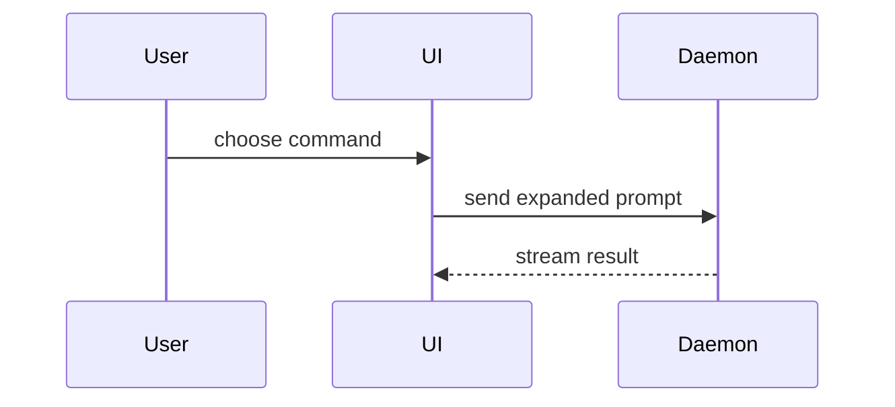

# Show Me

Help the owner understand how the system works visually. Skip the preamble and keep prose brief. Pick the smallest view that makes the key point clear.

- Show logic or an algorithm as pseudocode:

```text
on(save)
  if content is unchanged
    return cached result
  write new content
  return fresh result
```

- Show runtime control flow as a call tree:

```text
submitForm
  createSession
    persistPrompt
    launchAgent
  navigateToSession
```

- Show UI structure as a component tree, including state and module boundaries that matter:

```tsx
<SessionPage> (apps/example/src/routes/session.tsx)
  useSessionEvents()
  <SessionToolbar>
    <RunSkillButton> (packages/ui)
```

- Show file responsibility or a broad refactor as a shallow file tree:

```text
src/
├── commands/       # parses user actions
├── sessions/       # owns session state
└── transport/      # sends API requests
```

- Show component interaction, control flow, or data flow with Mermaid:



- Use `diff` when the point is what changes and the surrounding shape already exists. Match the diff shape to the topic.

For a component change:

```diff
 <SessionPage>
   useSessionEvents()
   <SessionToolbar>
+    <RunSkillButton />
   <SessionTimeline>
+    <SkillResultCard />
```

For a file-layout change:

```diff
 src/
 ├── commands/
+│   └── show-me.ts       # expands the slash command
 ├── sessions/
-└── transport.ts
+└── transport/
+    ├── client.ts
+    └── stream.ts
```

For a call-tree or call-stack change:

```diff
 submitForm
   createSession
     persistPrompt
+    expandSkillMention
     launchAgent
-  navigateToSession
+  navigateToSession
+    subscribeToEvents
```

For a state or control-flow change:

```diff
 on(save)
-  write content
+  if content is unchanged
+    return cached result
+  write new content
+  invalidate cache
```

- Show the whole block when most of it is new, when omitted context would hide ownership or order, or when the user needs a copyable target shape:

```ts
function expandSkill(command: string): string {
  const skillName = command.slice(1)
  return `use the ${skillName} skill`
}
```

- For a concept too dense for text or Mermaid, one focused HTML file can show
  a diagram, infographic, or short slide deck. Use real labels and data; support
  desktop and mobile. This is an opt-in artifact, not the default answer.

## Guidance

Place each visual next to the short text it supports. Keep only the calls, files, props, states, and boundaries needed to answer the user's current question or the options to resolve the current discussion point.

You may use one of these, you may use several, it is unlikely you will use all of them. Use your judgement and don't overwhelm the user.

## Inline by default

Place visuals in the answer or the document already being written. Loading this
skill is guidance, not authorization to create files or open a browser. An
informational “how does X work?” question authorizes an answer, not an edit;
`agent-kernel` owns that boundary and the final-response contract.

Write HTML only on explicit request or when the task already is producing that
artifact. Write one focused file, offer to open it, and open only when requested
(using `xdg-open` on Linux or `open` on macOS). Do not commit it unless asked.

## Durable docs

Read the implementation before drawing current-state diagrams. Cite the files
and functions each box or call maps to; do not invent components to fill a neat
shape. Prefer Mermaid or text that renders where the page lives (for example,
GitHub or Obsidian Markdown); use text when renderer support is uncertain.
Follow `codebase-docs` for placement and one home per fact, rather than creating
another explainer page. A diagram is not a substitute for the words a reader
needs to understand the mechanism and its limits.

## Where this stops

- Words around the visual → `plain-language`; visual form stays here. Do not
  load that skill just to produce an HTML sketch.
- Shipped wrapping prose → `unslop`; code-shaped visuals stay untouched.
- Durable source-tree doc placement and maintenance → `codebase-docs`.
- Architecture-review reports → `improve-codebase-architecture`, not this skill.
- Lessons and their after-lesson HTML → `teach`; inline visuals are fine, but
  do not write or open HTML mid-lesson.
- Product UI or visual redesign → `frontend-design`.

Adapted from HumanLayer / Dex Horthy's MIT `show-me` skill.
Copyright (c) 2026 HumanLayer; [MIT notice](../../../docs/research/raw/humanlayer-show-me/LICENSE).
